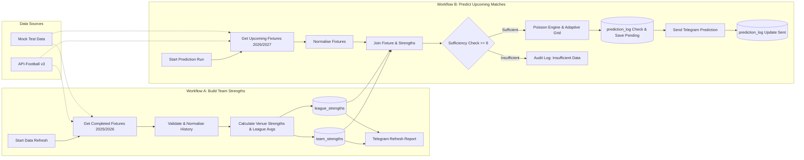

# Football Score Prediction Automation V1

A self-hosted, pre-match statistical prediction automation system built on **n8n Community Edition**, **API-Football v3**, **n8n Data Tables**, and the **Telegram Bot API**.

The system calculates venue-adjusted attacking and defensive metrics from completed historical football matches, models upcoming fixtures using an adaptive Poisson distribution, and delivers probabilistic match estimates directly to Telegram.

> [!IMPORTANT]
> **Probabilistic Estimates Only:** All outputs are pre-match statistical estimates. Football outcomes are inherently uncertain; these calculations are never presented as guaranteed results.

---

## Architecture Overview



---

## Verified System Status

- **Docker Environment:** Docker Desktop on Windows 11 + WSL2.
- **n8n Engine:** n8n Community Edition `2.46.7` running on `http://localhost:5678`.
- **Target Competition:** English Premier League (League `39`).
- **Historical Season (Workflow A):** `2025` (2025/2026 season data).
- **Upcoming Prediction Season (Workflow B):** `2026` (2026/2027 fixtures).
- **Persistence Engine:** 3 native n8n Data Tables (`team_strengths`, `league_strengths`, `prediction_log`).
- **Automated Test Suites:** 35 passing automated tests across 9 test files (100% pass rate).
- **Workflows Installed:** 4 active workflows imported into n8n and exported under `workflows/exports/`.

---

## Repository Structure

```text
Livescore-Automation/
│
├── .github/
│   └── copilot-instructions.md          # Project instructions and rules
│
├── .vscode/                             # VS Code workspace settings
│
├── docs/                                # Project documentation
│   ├── api-configuration.md             # API-Football credentials & quota budget
│   ├── data-table-setup.md              # 3 Data Table schemas (12, 7, 47 columns)
│   ├── design-decisions.md              # Architectural choices & justification
│   ├── environment-setup.md             # Docker Desktop & n8n setup guide
│   ├── implementation-guide.md          # Operator & beginner execution runbook
│   ├── legacy-livescore-reference.md    # Legacy LiveScore script catalog
│   ├── n8n-workflow-blueprint.md        # Node-by-node design specifications
│   ├── node-documentation.md            # JavaScript Code node reference
│   ├── project-overview.md              # Project goals and background
│   ├── system-architecture.md           # End-to-end data flow and model formulas
│   ├── testing-report.md                # Automated test results & hand-check
│   ├── testing-strategy.md              # Validation principles and guidelines
│   └── troubleshooting.md               # Common issues and solutions
│
├── src/
│   └── code-nodes/                      # Tested source JavaScript modules
│       ├── calculate-poisson.js         # Expected goals & adaptive Poisson grid
│       ├── calculate-team-strengths.js  # League and team venue aggregations
│       ├── data-table-schemas.js        # Data Table schema definitions
│       ├── format-prediction.js         # Telegram notification message formatter
│       ├── join-team-strengths.js       # Fixture-to-strength joins by numeric ID
│       ├── manage-prediction-state.js   # Deduplication & delivery state machine
│       ├── normalise-fixtures.js        # Upcoming fixture validation
│       ├── normalise-history.js         # Historical match normaliser (FT only)
│       ├── compare-scores.js            # Retained legacy live score comparator
│       └── filter-normalise.js          # Retained legacy fixture shaper
│
├── test-data/                           # Verified mock datasets
│   ├── mock-historical-fixtures.json    # 21 historical fixtures (FT, AET, PEN, DUP)
│   ├── mock-upcoming-fixtures.json      # 3 upcoming NS fixtures for season 2026
│   ├── mock-team-strengths.json         # Pre-calculated team & league strengths
│   ├── mock-prediction-log.json         # Sample prediction states (sent, failed)
│   └── mock-live-fixtures.json          # Retained legacy mock file
│
├── tests/                               # Automated test suites
│   ├── test-scenarios-a-to-t.js         # All 20 mandatory scenarios (A through T)
│   ├── test-poisson.js                  # Mathematical engine & hand-check
│   ├── test-normalisation.js            # Match normalisation and exclusions
│   ├── test-team-strengths.js           # League & team rate calculations
│   ├── test-deduplication.js            # State transitions & duplicate prevention
│   ├── test-workflow-scenarios.js       # Workflow A -> B integration test
│   ├── test-workflow-exports.js         # Structural verification of workflow JSONs
│   ├── test-table-schemas.js            # Data Table column & type contracts
│   └── test-api-budget.js               # Request quota budget validation
│
├── workflows/
│   └── exports/                         # Import-ready n8n workflow JSONs
│       ├── 00-setup-data-tables.json    # Table initialization workflow (12, 7, 47 cols)
│       ├── 01-build-team-strengths.json # Workflow A: Historical strength builder
│       ├── 02-predict-upcoming-matches.json # Workflow B: Prediction & Telegram delivery
│       └── 03-verify-api-access.json    # Diagnostics: API status & quota check
│
├── scripts/
│   └── generate-workflows.js            # Automated workflow generator & sync
│
├── compose.yaml                         # Docker Compose service definition
├── .env.example                         # Environment template (no secrets)
├── .gitignore                           # Git ignore rules
├── AGENTS.md                            # Agent instructions and rules
└── README.md                            # Main project overview
```

---

## Quickstart

### 1. Start n8n
```powershell
docker compose up -d
```
Visit `http://localhost:5678` in your browser.

### 2. Run Automated Tests
```powershell
node tests/test-scenarios-a-to-t.js
node tests/test-workflow-exports.js
```

### 3. Initialize Tables in n8n
In n8n (`http://localhost:5678`), open **SETUP - Create Prediction Data Tables** and click **Test workflow**.

### 4. Run Prediction Automation
- Open **Football Prediction — Build Team Strengths** and click **Test workflow**.
- Open **Football Prediction — Upcoming Match Predictions** and click **Test workflow**.
*(Both workflows default to `data_mode = 'mock'` so you can test them immediately without external API keys or Telegram tokens).*

For full instructions on configuring live API keys and Telegram credentials, see [docs/implementation-guide.md](docs/implementation-guide.md).
