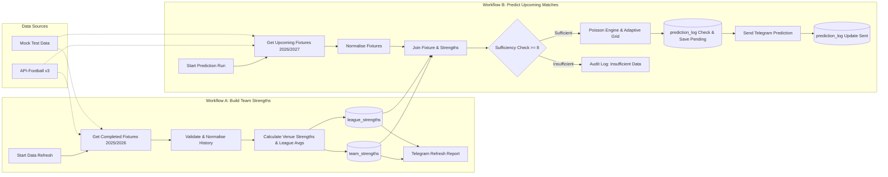

# Football Score Prediction Automation V1

A self-hosted, pre-match statistical prediction automation system built on **n8n Community Edition**, **API-Football v3**, **n8n Data Tables**, and the **Telegram Bot API**.

The system calculates venue-adjusted attacking and defensive metrics from completed historical football matches, models upcoming fixtures using an adaptive Poisson distribution, and delivers probabilistic match estimates directly to Telegram.

> [!IMPORTANT]
> **Probabilistic Estimates Only:** All outputs are pre-match statistical estimates. Football outcomes are inherently uncertain; these calculations are never presented as guaranteed results.

---

## Architecture Overview



---

## Verified System Status

- **Docker Environment:** Docker Desktop on Windows 11 + WSL2.
- **n8n Engine:** Container `livescore-n8n`, image/version `2.46.7`, running at `http://localhost:5678`; `/healthz` returned HTTP 200 on 2026-11-14.
- **Target Competition:** English Premier League (League `39`).
- **Historical Season (Workflow A):** `2025` (2025/2026 season data).
- **Upcoming Prediction Season (Workflow B):** `2026` (2026/2027 fixtures).
- **Local Automated Tests:** 35 passing tests across 9 files. This verifies JavaScript behavior and workflow-export structure, not n8n execution.
- **Workflow Exports:** Four valid, inactive JSON exports with 8, 15, 20, and 3 nodes. The n8n dashboard showed 4 workflows, but installed IDs, per-workflow node counts, active state, and execution history were not verified.
- **Data Tables:** Source and setup-export contracts define 12, 7, and 47 custom columns. Actual n8n table existence, schemas, and row counts were not verified.
- **Runtime Blocker:** n8n logs reported SQLite write-lock timeouts and database ping failures. Workflow and Data Table UI views stalled; no workflow was run and no table was initialized.
- **Mock Safety:** Existing mock paths are not isolated: Workflow A writes to production table names and reaches a Telegram node; Workflow B reads/writes production tables and reaches a Telegram node. Do not execute these mock paths until test-only tables/workflow copies and a no-send notification path are in place.
- **Live Integrations:** No API-Football request or Telegram message was sent. Credential presence and live data availability remain unverified.

---

## Repository Structure

```text
Livescore-Automation/
│
├── .github/
│   └── copilot-instructions.md          # Project instructions and rules
│
├── .vscode/                             # VS Code workspace settings
│
├── docs/                                # Project documentation
│   ├── api-configuration.md             # API-Football credentials & quota budget
│   ├── data-table-setup.md              # 3 Data Table schemas (12, 7, 47 columns)
│   ├── design-decisions.md              # Architectural choices & justification
│   ├── environment-setup.md             # Docker Desktop & n8n setup guide
│   ├── implementation-guide.md          # Operator & beginner execution runbook
│   ├── legacy-livescore-reference.md    # Legacy LiveScore script catalog
│   ├── n8n-workflow-blueprint.md        # Node-by-node design specifications
│   ├── node-documentation.md            # JavaScript Code node reference
│   ├── project-overview.md              # Project goals and background
│   ├── system-architecture.md           # End-to-end data flow and model formulas
│   ├── testing-report.md                # Automated test results & hand-check
│   ├── testing-strategy.md              # Validation principles and guidelines
│   └── troubleshooting.md               # Common issues and solutions
│
├── src/
│   └── code-nodes/                      # Tested source JavaScript modules
│       ├── calculate-poisson.js         # Expected goals & adaptive Poisson grid
│       ├── calculate-team-strengths.js  # League and team venue aggregations
│       ├── data-table-schemas.js        # Data Table schema definitions
│       ├── format-prediction.js         # Telegram notification message formatter
│       ├── join-team-strengths.js       # Fixture-to-strength joins by numeric ID
│       ├── manage-prediction-state.js   # Deduplication & delivery state machine
│       ├── normalise-fixtures.js        # Upcoming fixture validation
│       ├── normalise-history.js         # Historical match normaliser (FT only)
│       ├── compare-scores.js            # Retained legacy live score comparator
│       └── filter-normalise.js          # Retained legacy fixture shaper
│
├── test-data/                           # Verified mock datasets
│   ├── mock-historical-fixtures.json    # 21 historical fixtures (FT, AET, PEN, DUP)
│   ├── mock-upcoming-fixtures.json      # 3 upcoming NS fixtures for season 2026
│   ├── mock-team-strengths.json         # Pre-calculated team & league strengths
│   ├── mock-prediction-log.json         # Sample prediction states (sent, failed)
│   └── mock-live-fixtures.json          # Retained legacy mock file
│
├── tests/                               # Automated test suites
│   ├── test-scenarios-a-to-t.js         # All 20 mandatory scenarios (A through T)
│   ├── test-poisson.js                  # Mathematical engine & hand-check
│   ├── test-normalisation.js            # Match normalisation and exclusions
│   ├── test-team-strengths.js           # League & team rate calculations
│   ├── test-deduplication.js            # State transitions & duplicate prevention
│   ├── test-workflow-scenarios.js       # Workflow A -> B integration test
│   ├── test-workflow-exports.js         # Structural verification of workflow JSONs
│   ├── test-table-schemas.js            # Data Table column & type contracts
│   └── test-api-budget.js               # Request quota budget validation
│
├── workflows/
│   └── exports/                         # Import-ready n8n workflow JSONs
│       ├── 00-setup-data-tables.json    # Table initialization workflow (12, 7, 47 cols)
│       ├── 01-build-team-strengths.json # Workflow A: Historical strength builder
│       ├── 02-predict-upcoming-matches.json # Workflow B: Prediction & Telegram delivery
│       └── 03-verify-api-access.json    # Diagnostics: API status & quota check
│
├── scripts/
│   └── generate-workflows.js            # Automated workflow generator & sync
│
├── compose.yaml                         # Docker Compose service definition
├── .env.example                         # Environment template (no secrets)
├── .gitignore                           # Git ignore rules
├── AGENTS.md                            # Agent instructions and rules
└── README.md                            # Main project overview
```

---

## Quickstart

### 1. Start n8n
```powershell
docker compose up -d
```
Visit `http://localhost:5678` in your browser.

### 2. Run Automated Tests
```powershell
node --test
node tests/test-workflow-exports.js
```

### 3. Initialize Tables in n8n
Do not run setup until n8n database access is stable and the current tables have been inspected in the UI. The setup workflow export preflights existing schemas and uses create-if-missing operations, but no runtime tables were inspected or initialized in this phase.

### 4. Run Prediction Automation
Do not execute the existing Workflow A or B in mock mode yet. Their current mock branches write to production Data Tables, and the Telegram nodes are not disabled for mock runs. First create isolated test tables/workflow copies (or add an explicit no-send test branch), then validate the whole mock pipeline.

For full instructions on configuring live API keys and Telegram credentials, see [docs/implementation-guide.md](docs/implementation-guide.md).
