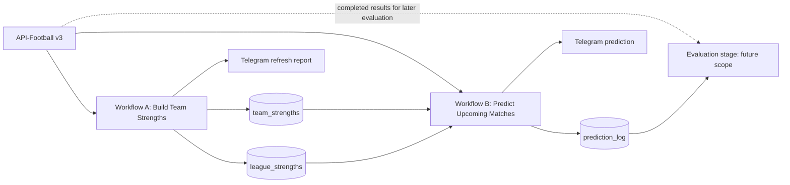

# n8n Workflow Blueprint

**Project:** Football Score Prediction Automation

**Status:** Design only. No workflow, table, credential, API request, script implementation, or schedule was created by this blueprint.

## 1. Scope and verified environment

The system has two separate n8n workflows. Workflow A builds historical strength snapshots. Workflow B consumes those snapshots to make pre-match probability estimates. JavaScript Code nodes own transformations and statistical calculations; n8n nodes orchestrate API, persistence, branching, and Telegram delivery.

A fresh environment check on 2026-11-12 found:

- Docker Desktop reports `starting` with a session ID.
- WSL2 default version is 2, but both Ubuntu and `docker-desktop` are stopped.
- `docker info` returns HTTP 500 from the Docker Desktop engine pipe.
- `docker compose ps` cannot query the engine.
- `http://localhost:5678/healthz` is unavailable.
- The local Git branch is `main`, tracking `origin/main`.

Therefore the prior n8n version/container/volume report is not current runtime proof. Do not repair Docker, recreate a container, or touch persistent data in this phase. Live workflow construction and UI-version checks are blocked until Docker/n8n is restored. The blueprint below is based on the committed project documents and official online n8n documentation; it is not an n8n export.

## 2. Requirements versus recommendations

### Original assignment requirements

- Keep two workflows: **Build Team Strengths** and **Predict Upcoming Matches**.
- Read completed historical fixtures, validate and normalise them, calculate league home/away averages and team home/away goals-for/goals-against counts, and write league and team records separately.
- Read upcoming fixtures, match teams by numeric IDs plus league/season, calculate expected goals and a Poisson 0-5 score grid, rank three scorelines, derive home/draw/away probabilities, prevent repeat prediction delivery, and log predictions.
- Use the three requested Data Tables and field lists in Section 5.
- Do not silently drop fixtures without strengths; explain insufficient-data outcomes.
- Do not create the workflows, tables, credentials, scripts, live API calls, or schedules in this phase.

### Recommendations, explicitly not silently adopted requirements

- Use the API's reported `paging.current` and `paging.total` to fetch every historical page; do not assume one response is complete.
- Aggregate deterministic, completed, in-window fixtures, retain rejected counts, and make refresh writes repeatable.
- Serialize prediction runs while using Data Tables because documented condition-based Upsert is not a database uniqueness guarantee.
- Store a `pending` prediction before Telegram delivery, then update it to `sent` only on confirmed success or `failed` on an explicit error. This deliberately improves on the original send-then-save ordering.
- Compute outcome probabilities on an expanded/adaptive goal range and report residual probability mass; keep the assignment's 0-5 values visible for comparison.
- Extend the prediction log or create an evaluation dataset before implementing evaluation. The original columns alone do not retain all requested message content or the eventual actual score.

## 3. System architecture



The workflows are separate so a reviewed refresh can be run independently and prediction runs do not recompute historical aggregates for every fixture. The Data Tables are the hand-off between them. The diagram is conceptual; no resources currently exist in n8n as a result of this design task.

## 4. Workflow A: Build Team Strengths

### Data Settings payload

Use an **Edit Fields (Set)** node with explicit values. One execution should cover one league-season unless multi-league batching is designed later.

```json
{
  "league_id": 39,
  "season": 2025,
  "timezone": "Africa/Lagos",
  "minimum_matches": 8,
  "historical_cutoff_date": "2026-11-11T23:59:59Z",
  "run_started_at": "2026-11-12T00:00:00Z"
}
```

The example IDs, season, sample threshold, and dates are illustrative only, not selected project settings. `minimum_matches` must not create fabricated values: it is used to mark each venue side as adequate/insufficient or to block a model refresh under an agreed policy. The cutoff is exclusive/inclusive behavior to define; recommended interpretation is include only completed fixture dates at or before the UTC cutoff.

### Node-by-node plan

| ID | Canvas name | n8n node type | Responsibility; input -> output | Configuration and expressions | Connections, failure behavior, test |
| --- | --- | --- | --- | --- | --- |
| A1 | Start Data Refresh | Manual Trigger | Starts an operator-controlled refresh; emits one trigger item. | Use Manual Trigger first. Add a schedule only after review and a separate authorization. | -> A2. Test: manual execution starts once; no schedule is active. |
| A2 | Data Settings | Edit Fields (Set) | Defines one league-season run; outputs settings shown above. | Keep only set fields. Validate positive numeric IDs/year/threshold, valid IANA timezone, and a parseable cutoff. No secrets here. | -> A3. The settings travel in the request/run envelope; invalid settings -> failure report. Test each invalid value. |
| A3 | Get Completed Fixtures | HTTP Request | Fetches every results page from `GET https://v3.football.api-sports.io/fixtures`; emits one response item per page. | Method GET; query `league={{$json.league_id}}`, `season={{$json.season}}`, `status=FT` as the initial candidate, `page` starting at 1, and timezone only if verified supported. API credential must be Header Auth `x-apisports-key`, held in n8n Credentials. Enable full response/status for validation. HTTP Request pagination: update `page` each call (for example `={{ $pageCount + 1 }}`) and stop only when the response's current page reaches reported total pages. Confirm exact UI expression on the installed node version. Keep request errors as workflow errors or route them to failure handling; do not continue a partial page set. | -> A3a. Test one page, multiple pages, HTTP failure, and API error envelope with mocks. |
| A3a | Collect History Pages | Code (JavaScript, run once for all items) | Collects all page response items into one envelope; records page count, each page's status/errors/response/paging values, and whether pages 1..total are present exactly once. | Set `api_check.ok=false` for any missing/duplicate page, non-2xx, non-empty API errors, malformed response array, or inconsistent `paging.current/total`. Preserve every response body for A5 only when the complete set is valid. Read settings through the named Data Settings node. | -> A4. No partial envelope goes down the valid path. Test a middle page failed/missing while other pages succeeded; the overall result must be false. |
| A4 | API Response OK? | IF | Makes one all-or-nothing decision over the collected pagination run, not one decision per page. | Condition `{{$json.api_check.ok === true}}`; `api_check` is produced by A3a after validating every page and reported pagination total. | True -> A5. False -> A14. Never continue with a partial or API-error page set. Test empty successful response separately from invalid/error. |
| A5 | Validate & Normalise History | Code (JavaScript, run once for all fixtures) | Reads the complete page envelope and settings; returns one normalized run envelope containing fixtures, rejected count, and rejection reasons. Each accepted fixture has the schema below. | Flatten only after A4 confirms all pages are complete. Inspect actual response structure before fixing field access. Map fixture/league/team IDs, names, date, status, and regulation full-time goals. Reject null/undefined/non-integer/negative scores, missing IDs/date, non-completed status, and dates after the as-of cutoff. Do not turn missing goals into zero. Keep original status and reason counters. | -> A6. Structural API change or no usable fixtures -> fail/report; record rejected examples without credentials. Test complete, missing, null, negative, decimal, postponed, future, and malformed fixtures. |
| A6 | Calculate League & Team Rates | Code (JavaScript, run once for all fixtures) | Consumes the normalized envelope; produces a single envelope with `team_rows[]`, one `league_row`, run counts, and adequacy flags. Aggregates totals by numeric IDs and venue. | `matches_used = valid fixture count`; league means are `sum(home_goals)/matches_used` and `sum(away_goals)/matches_used`. Per-team home/away counts and goals for/against are integers. Construct `team_key = league_id + '|' + season + '|' + team_id`; `league_key = league_id + '|' + season`. Set one ISO `updated_at`. If `matches_used===0`, stop rather than divide by zero. Do not calculate/divide strength factors here unless the formulas and minimum sample policy are approved; requested table stores counts/totals. | Branch -> A7 and A9. Failure -> refresh failure branch; no writes if aggregation invalid. Test hand-calculated matches, duplicate fixture IDs, empty input, zero denominator, and stable ID grouping when names collide. |
| A7 | Split Team Strength Rows | Split Out | Converts `team_rows[]` into one incoming item per team for row-wise Data Table Upsert. | Split field `team_rows`; retain only fields for the team table. Ensure A6 always produces at least one valid team row or errors explicitly. | -> A8. Test 1 and many teams; verify output item count. |
| A8 | Save Team Strengths | Data Table: Row / Upsert | Idempotently writes team records. | Select `team_strengths`; **Must Match: All Conditions**; condition `team_key Equals {{$json.team_key}}`; map each column explicitly or map automatically only if names match exactly. For one condition, All is equivalent to that condition. | -> A11 Input 1. Any write error prevents success report and routes to failure handling. Test repeat same refresh and confirm row count stays stable. |
| A9 | Prepare League Strength Row | Edit Fields (Set) | Selects the single `league_row` from A6 for the competition-level branch. | Map exact league columns; do not pass the full team array into the league table. | -> A10. Missing/multiple league row -> Stop And Error. Test exactly one row. |
| A10 | Save League Strengths | Data Table: Row / Upsert | Writes one league average record, separate from team records. | Select `league_strengths`; **Must Match: All Conditions**; `league_key Equals {{$json.league_key}}`; map the seven specified fields. | -> A11 Input 2. Any failure blocks success report. Test re-run updates the existing league row rather than adding one. |
| A11 | Wait for Both Saves | Merge (Append, 2 inputs) | Completion barrier: waits for both write branches. Appends returned items only as a synchronization mechanism; the output may contain many rows. | Mode Append, 2 inputs. This mode waits for every connected input. It is not a join by position and its output must not feed Telegram directly. Verify Merge execution-order behavior in a test instance. | -> A12. A failed branch must fail the execution; don't send a green success report when only one table saved. Test deliberately fail each branch. |
| A12 | Build One Refresh Report | Code (JavaScript, run once for all items) | Collapses the barrier output into exactly one report item using counts from A6 and write results. | Read run metadata via named-node references, not array position. Output one `{text, league_id, season, matches_used, team_rows_written, rejected_count, updated_at}` item. Include partial/rejected counts and the cutoff. | -> A13. Missing branch data or inconsistent write counts -> fail report. Test with 0, 1, and many team rows; output item count must always be exactly one. |
| A13 | Data Refresh Report | Telegram: Send Message | Sends one success message only after both writes complete. | Use Telegram credentials in n8n Credentials. One report item -> one message. Include league/season, fixtures accepted/rejected, teams written, average home/away goals, cutoff, timestamp, and a warning for insufficient sample coverage. Do not include secrets. | End. Telegram failure must be marked as report-delivery failure; do not re-run the data writes blindly. Test with a mock/reviewed test bot before production chat. |
| A14 | Build Refresh Failure Report | Code (JavaScript, run once for all items) | Collapses error-output items and validation failures into one sanitized failure summary. | Include run scope and safe error category/message only; never copy request headers, credential objects, or full secret-bearing payloads. If using a global Error Workflow, use an Error Trigger in that separate workflow instead of treating it as a connected node here. | Error outputs from A2-A10 and false output from A4 -> A14 -> A15. Test each failure source and confirm one summary. |
| A15 | Send Refresh Failure Report | Telegram: Send Message | Sends one failure report, distinct from the success report. | Use a separate approved operator chat/credential; include execution reference, league/season, stage, and whether writes may have partially completed. | End failure path. Telegram failure is surfaced to n8n execution/error workflow; never label a partial write as successful. |

### Workflow A wiring

| From | To | Route/port | Purpose |
| --- | --- | --- | --- |
| A1 | A2 | Main | Start a manual run and set its bounded league-season context. |
| A2 | A3 | Main | Supply query parameters and cutoff settings. |
| A3 | A3a | Main | Collect every page response from HTTP pagination. |
| A3a | A4 | Main | Submit one envelope describing the full page set. |
| A4 | A5 | True | Continue only if all pages and API envelopes are valid. |
| A4 | A14 | False | Report API errors, page gaps, or malformed responses; no writes. |
| A5 | A6 | Main | Send normalized completed fixtures into aggregation. |
| A6 | A7 | Main | Split team row array for per-team Upsert. |
| A7 | A8 | Main | Write team table rows. |
| A6 | A9 | Main | Select the one league summary row. |
| A9 | A10 | Main | Upsert the league summary. |
| A8 | A11 | Input 1 | Signal completion of team writes. |
| A10 | A11 | Input 2 | Signal completion of league write. |
| A11 | A12 | Main | Collapse both branches to one report item. |
| A12 | A13 | Main | Send exactly one success report. |
| A2-A10 error outputs | A14 | Error | Aggregate a failure report; keep this disconnected from the success path. |
| A14 | A15 | Main | Send exactly one failure report. |

Data Table rows are per-item writes; the Merge output is intentionally not connected directly to Telegram. If either required write fails, do not release the success path.

### Normalized history item

```json
{
  "fixture_id": 123456,
  "league_id": 39,
  "season": 2025,
  "home_team_id": 42,
  "away_team_id": 49,
  "home_team": "Home FC",
  "away_team": "Away FC",
  "home_goals": 2,
  "away_goals": 1,
  "match_date": "2025-08-15T19:00:00+00:00",
  "match_status": "FT"
}
```

`match_status` must preserve the source value. `FT` is a candidate filter, not an API status assertion validated in this research run. Decide whether matches ending `AET`/`PEN` belong in a regulation-score model; the score definition must be consistent. Historical fixture cutoff and completed status are both required to avoid leakage.

### Workflow A calculation output shape

```json
{
  "run": {
    "league_id": 39,
    "season": 2025,
    "matches_used": 10,
    "rejected_count": 0,
    "updated_at": "2026-11-12T00:00:00.000Z"
  },
  "league_row": {
    "league_key": "39|2025",
    "league_id": 39,
    "season": 2025,
    "league_home_avg": 1.5,
    "league_away_avg": 1.1,
    "matches_used": 10,
    "updated_at": "2026-11-12T00:00:00.000Z"
  },
  "team_rows": [
    {
      "team_key": "39|2025|42",
      "league_id": 39,
      "season": 2025,
      "team_id": 42,
      "team_name": "Home FC",
      "home_played": 5,
      "home_goals_for": 9,
      "home_goals_against": 4,
      "away_played": 5,
      "away_goals_for": 6,
      "away_goals_against": 7,
      "updated_at": "2026-11-12T00:00:00.000Z"
    }
  ]
}
```

The values above are illustrative only. Aggregate code should use integer sums/counts and derive averages from the common valid match set.

## 5. Three Data Table schemas

Create these manually/review their n8n columns only in a later authorized implementation phase. Current documented n8n Data Table node supports Row `Get`, `Upsert`, `Update`, and related operations. Row operations allow multiple conditions and a **Must Match** choice of **All Conditions** or **Any Condition**. Upsert updates matching rows or inserts a new row if none match. The docs do not describe a unique index or transaction lock for these table schemas; do not claim that a condition-based Upsert is race-proof.

### `team_strengths`

| Column | Type | Purpose / matching |
| --- | --- | --- |
| `team_key` | String | Composite `league_id|season|team_id`; recommended single condition key |
| `league_id` | Number | Competition ID |
| `season` | Number | Season identifier |
| `team_id` | Number | Stable numeric API team ID |
| `team_name` | String | Display only; never join by name |
| `home_played` | Number | Completed home appearances used |
| `home_goals_for` | Number | Home goals scored |
| `home_goals_against` | Number | Home goals conceded |
| `away_played` | Number | Completed away appearances used |
| `away_goals_for` | Number | Away goals scored |
| `away_goals_against` | Number | Away goals conceded |
| `updated_at` | String | ISO-8601 UTC refresh time |

### `league_strengths`

| Column | Type | Purpose / matching |
| --- | --- | --- |
| `league_key` | String | Composite `league_id|season`; recommended single condition key |
| `league_id` | Number | Competition ID |
| `season` | Number | Season identifier |
| `league_home_avg` | Number | Included home goals / matches used |
| `league_away_avg` | Number | Included away goals / matches used |
| `matches_used` | Number | Number of valid completed fixtures |
| `updated_at` | String | ISO-8601 UTC refresh time |

### `prediction_log`

| Column | Type | Purpose / matching |
| --- | --- | --- |
| `fixture_id` | String | API fixture ID converted to a string |
| `model_version` | String | Immutable version label for the approved formula/configuration |
| `home_team` | String | Display label |
| `away_team` | String | Display label |
| `lambda_home` | Number | Home expected goals |
| `lambda_away` | Number | Away expected goals |
| `top_score` | String | Highest-ranked score, e.g. `1-0`; only the top score is in the original schema |
| `home_win_prob` | Number | Probability as fraction 0-1, unless reviewed otherwise |
| `draw_prob` | Number | Probability as fraction 0-1 |
| `away_win_prob` | Number | Probability as fraction 0-1 |
| `status` | String | At minimum `pending`, `sent`, `failed`; define stale-pending handling |
| `predicted_at` | String | ISO-8601 UTC creation time |

**Matching:** the requested criteria are `fixture_id + model_version`. Data Table Upsert can be configured with **Must Match: All Conditions** and equality conditions on both columns. `Any Condition` is unsafe because it could match a different fixture with the same model or a different model for the same fixture. An optional `prediction_key = fixture_id + '|' + model_version` string can simplify lookups, but it does not itself enforce uniqueness.

**Duplicate-notification safety:** query existing records with both equality conditions (or a scoped log query followed by exact key comparison), skip `sent` and `pending`, and serialize runs to reduce races. If `failed`, follow the reviewed retry policy. Data Table Upsert is not documented as an atomic unique insert: concurrent executions can both observe no row and insert. Strict exactly-once external delivery cannot be guaranteed across a network timeout without an atomic idempotency mechanism at the destination. A `pending -> sent/failed` state machine makes recovery visible but does not alone eliminate that race.

**Evaluation gap:** `top_score` stores only one score although the Telegram message requires three. The requested log also has no actual score/result, evaluation timestamp, competition/date snapshot, or strength snapshot. `lambda_home`/`lambda_away` plus a frozen model version can reproduce Poisson outputs only if formulas and parameters are immutable and fully recoverable. Recommended later schema review: `top_scores_json`, actual full-time goals/outcome, `evaluated_at`, and prediction provenance. Do not add columns until approved.

## 6. Workflow B: Predict Upcoming Matches

### Prediction Settings payload

```json
{
  "league_id": 39,
  "season": 2025,
  "timezone": "Africa/Lagos",
  "fixture_from": "2026-11-12",
  "fixture_to": "2026-11-18",
  "minimum_matches": 8,
  "model_version": "poisson-baseline-v1",
  "goal_grid_max": 5
}
```

Illustrative only. Keep model version immutable: changing formulas, inclusion rules, or grid semantics requires a new version and review. Display kickoff in the selected timezone; store timestamps in UTC.

### Node-by-node plan

| ID | Canvas name | n8n node type | Responsibility; input -> output | Configuration and expressions | Connections, failure behavior, test |
| --- | --- | --- | --- | --- | --- |
| B1 | Start Prediction Run | Manual Trigger | Starts an operator-controlled batch. | Manual first; scheduling only after successful review and separate authorization. | -> B2. Test no automatic run exists. |
| B2 | Prediction Settings | Edit Fields (Set) | Defines one league-season and date-window batch. | Validate IDs, dates, timezone, model version, sample threshold, and `goal_grid_max`. One league-season per execution is the initial design for bounded table reads. | -> B3, B6, B7, and log read helper. Invalid settings stop before HTTP/table work. |
| B3 | Get Upcoming Fixtures | HTTP Request | Fetches upcoming fixtures from the fixtures endpoint with all pages as required. | GET `/fixtures`; query `league`, `season`, `from`, `to`; optional upcoming `status` only after verifying API's current status codes. Header credential in n8n. Use timezone query only if officially supported. Pagination based on reported page metadata, not one-page assumption. | -> B3a. Request error must not be treated as a complete fixture batch. Test multiple pages, zero fixtures, errors, bad dates. |
| B3a | Collect Upcoming Pages | Code (JavaScript, run once for all items) | Collects all page responses and proves every expected page exists once with valid HTTP/API status and response shape. | Produce one `{api_check, pages, settings}` envelope; set false for page gaps, duplicate page numbers, API errors, malformed response, or paging inconsistency. | -> B4. Test failure on one middle page while earlier/later pages exist; whole run must fail closed. |
| B4 | API Response OK? | IF | Makes one all-or-nothing decision for the complete paginated fixture request. | Condition `{{$json.api_check.ok === true}}`; never evaluate each page independently. | True -> B5. False -> controlled failure report. Test API error and empty successful fixture set separately. |
| B5 | Normalise Upcoming Fixtures | Code (JavaScript) | Converts API fixture entries into stable prediction inputs. | Emit one item per fixture with fixture ID, league ID/name, season, match date, status, home/away numeric IDs and names. Do not infer identity from names. Use timezone conversion only for message display. | -> B8 input 1 and audit counts. Reject malformed IDs/date/status to a visible invalid-fixture summary. Test duplicate IDs, same team names with different IDs, invalid/finished fixtures. |
| B6 | Read Team Strengths | Data Table: Row / Get | Loads all teams for the selected league-season once; output is used for ID lookup. | Table `team_strengths`; Must Match **All Conditions**: `league_id Equals {{$json.league_id}}`, `season Equals {{$json.season}}`; Return All. Enable **Always Output Data** in node settings if empty results otherwise stop the downstream barrier; filter any placeholder. | -> B8 input 2. Table error is fatal to the run; zero rows continue to B9 as insufficient history. Test empty table and duplicate team keys. |
| B7 | Read League Strengths | Data Table: Row / Get | Retrieves the matching competition averages. | Table `league_strengths`; Must Match **All Conditions** on `league_id` and `season` (or `league_key Equals {{$json.league_id + '|' + $json.season}}`); limit 2 to detect duplicate records. Always output a placeholder for no match. | -> B8 input 3. Missing/duplicate league row is not silently selected; mark all affected fixtures insufficient. Test 0, 1, and >1 result. |
| B8a | Wait for Fixture and Lookups | Merge (Append, 3 inputs) | Synchronizes normalized fixtures, team rows, and league row before join code executes. | Mode Append, 3 inputs. It is a barrier only; output ordering is irrelevant and must not be used as a join key. Ensure B5 emits an empty-run sentinel item when there are zero fixtures and table reads output placeholders when empty. | -> B8. Test unbalanced input counts and an empty team table; no positional merging. |
| B8 | Join Fixture and Team Strengths | Code (JavaScript, run once for all items) | Builds a map from team-strength rows keyed by `league_id|season|team_id`, and a league map keyed by `league_id|season`; returns every normalized fixture enriched with home row, away row, league row, and data-status reasons. | Read source items by node name using n8n item APIs (for example `$('Normalise Upcoming Fixtures').all()` and `$('Read Team Strengths').all()`); do not read merged `items` by order. Detect duplicate composite keys and mark ambiguous lookup as insufficient. Check numeric key equality and league-season for every lookup. | -> B9. Keep fixtures even when either team/league is missing. Join exception -> fail report; duplicate or missing data -> explicit insufficiency branch. Test shuffled table order and colliding team names. |
| B9 | Check Historical Data Sufficiency | IF | Routes each fixture based on league row and both team rows, positive required denominators, finite positive league averages, and agreed home/away sample minimums. | Example condition after join: `{{$json.data_quality.sufficient === true}}`. Reasons include missing league average, missing home/away team, duplicate key, zero home/away appearances, or below minimum count. | True -> B10. False -> B9a. No fixture is dropped. Test each reason separately. |
| B9a | Aggregate Insufficient Fixtures | Code (JavaScript, run once for all items) | Collects all insufficient fixtures and reason codes into one operator report item so one bad run does not flood Telegram with one message per fixture. | Include fixture ID, teams, league/season, and explicit reason; no invented stats/probabilities. | -> B9b Telegram diagnostic or reviewed run log. Test 0/1/many insufficient items; one diagnostic per run. |
| B9b | Insufficient Data Report | Telegram: Send Message | Explains why specific fixtures were not predicted reliably. | Use a separate diagnostic template and configured operator chat credential. If no insufficiencies, this branch does not run. | End branch. Telegram failure is recorded as execution error; must not convert fixture to a prediction. |
| B10 | Calculate Score Probabilities | Code (JavaScript) | Calculates attack/defence rates, expected goals, goal PMFs, scoreline distribution, top three scores, and outcome probabilities for sufficient fixtures. | Use only the formulas in Section 7; reject non-finite/negative values and zero denominators. Retain both 0-5 baseline and expanded-grid probabilities until policy is approved. Never renormalize truncated probabilities without labelling the conditional result. | -> B11. Invalid computation routes to a calculation failure summary; test against the hand-check in Section 8. |
| B11 | Format Prediction Message | Code (JavaScript) | Converts prediction data to exactly one message payload per fixture, plus a log row object. | Include home/away, competition, local kickoff and timezone, top three scorelines with unconditional probability, expected goals, home/draw/away probabilities, model version, and uncertainty disclaimer. Escape Telegram Markdown/HTML according to selected parse mode. | -> B12b gate input 1. Format failure stops that fixture and reports it; test names with markup characters and missing competition label. |
| B12a | Read Prediction Log | Data Table: Row / Get | Fetches existing model-version log rows for exact duplicate comparison. | Table `prediction_log`; filter by `model_version Equals {{$json.model_version}}`, Return All. If table size grows, evaluate pagination and partitioning. Always Output Data for an empty table. | -> B12b input 2. A read error must fail closed: do not send possibly duplicate predictions. Test empty table and multiple existing rows. |
| B12b | Wait for Prediction Candidates and Log | Merge (Append, 2 inputs) | Waits until formatted candidates and prior-log rows are both available. | Append mode; output item order has no meaning. | -> B12 Code. Test empty prior log and unequal counts. |
| B12 | Check Prediction Log | Code (JavaScript, run once for all items) | Exact set lookup by fixture ID string plus model version. Removes only records already `sent` or `pending`; returns fresh candidates and duplicate counts. | Build `key = String(fixture_id) + '|' + model_version`. Treat an existing `failed` row according to an approved retry policy. If more than one row has a key, fail closed and report duplicates. | -> B12c for new items. Duplicate items -> aggregate count/report; no send. Test same fixture/different model, same model/different fixture, sent/pending/failed. |
| B12c | Reserve Prediction as Pending | Data Table: Row / Upsert | Recommended reliability improvement: save complete prediction row with `status='pending'` before external send. | Match both `fixture_id Equals {{$json.fixture_id}}` and `model_version Equals {{$json.model_version}}`, **Must Match All Conditions**. Upsert is not an atomic unique lock; serialize workflow runs and check for stale pending rows. | -> B13. If reservation fails, do not send. Test repeat and simulated overlapping runs. |
| B13 | Send Prediction | Telegram: Send Message | Sends only reserved new predictions. | One input per fixture; Telegram credential from n8n Credentials; payload text from B11; no credentials in message/log. | Success -> B14 Update Prediction Status. Error output -> B15. Consider timeout as ambiguous delivery, not proof Telegram did not receive it. Test success, hard failure, and simulated timeout. |
| B14 | Save Prediction | Data Table: Row / Update | Sets `status='sent'` and any delivery timestamp only after Telegram confirms success. This is the recommended form of the save stage. | Update by **All Conditions** on string `fixture_id` and `model_version`. Ensure all prediction fields from B11 are retained in the pending row; don't depend on Telegram output carrying prior input. | End. Update failure after send is an ambiguous state needing operator reconciliation; do not automatically resend. Test successful update and deliberate update failure. |
| B15a | Handle Notification Failure | Code (JavaScript) | Converts a Telegram error output into a safe status-update item while preserving the original fixture/model key. | Keep only fixture ID, model version, safe error class/code, and timestamp. Never persist credentials, headers, or the full request/response. Mark timeouts as ambiguous rather than assuming delivery failed. | Telegram error output -> B15a -> B15b. Test 4xx, rate limit, and timeout shapes. |
| B15b | Save Failed Delivery Status | Data Table: Row / Update | Updates the reserved prediction's status to `failed` after an explicit Telegram error. | Match both `fixture_id` and `model_version` with **Must Match: All Conditions**. For ambiguous timeouts, use a separately approved reconciliation status/policy instead of blind retry. | -> B15c. Update failure goes to n8n execution error handling. Test update missing-row and duplicate-row cases. |
| B15c | Report Notification Failure | Telegram: Send Message | Alerts the operator to a failed/ambiguous delivery without resending the prediction automatically. | Aggregate by run when practical; include fixture key, failure category, and next operator action. | End failure branch. Test Telegram alert failure without recursive alert loops. |

### Workflow B wiring

| From | To | Route/port | Purpose |
| --- | --- | --- | --- |
| B1 | B2 | Main | Start an operator-controlled run and define the scope. |
| B2 | B3 | Main | Request upcoming fixture pages. |
| B3 | B3a | Main | Collect all paginated responses. |
| B3a | B4 | Main | Validate the complete page set as one unit. |
| B4 | B5 | True | Normalize only a complete successful API result. |
| B4 | Failure report | False | Stop before any prediction or notification. |
| B5 | B8a | Input 1 | Fixture stream for the synchronization barrier. |
| B2 | B6 | Main | Read team rows scoped to league and season. |
| B6 | B8a | Input 2 | Provide team-strength records. |
| B2 | B7 | Main | Read league average row for the same scope. |
| B7 | B8a | Input 3 | Provide league-strength record(s). |
| B8a | B8 | Main | Start the ID-based join after all inputs arrive. |
| B8 | B9 | Main | Keep one enriched item per fixture, including missing-data reasons. |
| B9 | B10 | Sufficient | Calculate only when all required historical rows and denominators are valid. |
| B9 | B9a | Insufficient | Aggregate reasons and preserve fixtures that cannot be predicted. |
| B9a | B9b | Main | Send one insufficiency diagnostic per run. |
| B10 | B11 | Main | Format calculated probability results for delivery and logging. |
| B11 | B12b | Input 1 | Provide candidates to the duplicate-check barrier. |
| B2 | B12a | Main | Read prediction history for the selected model version. |
| B12a | B12b | Input 2 | Provide existing history rows. |
| B12b | B12 | Main | Check exact fixture/model keys using named-node data, not input order. |
| B12 | B12c | New only | Reserve fresh prediction as pending; existing sent/pending records skip. |
| B12c | B13 | Main | Send only after a pending record exists. |
| B13 | B14 | Success | Mark the reserved row sent after Telegram success. |
| B13 | B15a | Error output | Classify explicit/ambiguous notification failure. |
| B15a | B15b | Main | Persist failed state for confirmed failures. |
| B15b | B15c | Main | Alert operator; never automatically resend an ambiguous delivery. |

`Failure report` in the B4 false route should use the same explicit sanitized Code/Telegram pattern as A14/A15. The `New only` output of B12 must also retain a separate duplicate-count route for audit; it must not enter the Telegram node.

### Upcoming fixture and joined item shapes

```json
{
  "fixture_id": "123456",
  "league_id": 39,
  "league_name": "Example League",
  "season": 2025,
  "match_date": "2026-11-14T17:30:00Z",
  "home_team_id": 42,
  "away_team_id": 49,
  "home_team": "Home FC",
  "away_team": "Away FC"
}
```

After B8 join, add `home_strength`, `away_strength`, `league_strength`, and `data_quality: {sufficient, reasons: []}`. B9 routes this item; it must not discard missing records.

## 7. Expected goals and Poisson model

### Original assignment baseline

For team home and away measurements:

- `home_attack = (home_goals_for / home_played) / league_home_avg`
- `home_defence_weakness = (home_goals_against / home_played) / league_away_avg`
- `away_attack = (away_goals_for / away_played) / league_away_avg`
- `away_defence_weakness = (away_goals_against / away_played) / league_home_avg`

Then:

- `lambda_home = league_home_avg * home_team_home_attack * away_team_away_defence_weakness`
- `lambda_away = league_away_avg * away_team_away_attack * home_team_home_defence_weakness`

For goal count `k` and expected-goal rate `lambda`:

$$P(k;\lambda)=e^{-\lambda}\frac{\lambda^k}{k!}$$

Under the independent-team-score assumption, scoreline probability is:

$$P(H=h,A=a)=P(h;\lambda_{home})P(a;\lambda_{away})$$

The independence assumption follows the usual baseline construction but must be confirmed as an accepted model assumption. Validate `lambda >= 0`, all denominators > 0, and every probability finite. Implement factorial iteratively or use recurrence `P(0)=exp(-lambda)`, `P(k)=P(k-1)*lambda/k` to avoid large factorial overflow.

For a finite grid 0..K, the assignment's scoreline probabilities are unconditional masses, not percentages conditioned on being in the grid. Rank the scorelines by the product above. Sum home outcomes where `h>a`, draws where `h=a`, and away outcomes where `h<a`; the three sums will be less than 1 if tail probability is omitted.

### Recommended tail treatment (separate from baseline)

Keep the 0-5 grid as the assignment comparison. For final outcome probabilities, increase K until each marginal tail is below an agreed epsilon; for independent scores, omitted joint mass is bounded by the sum of the two marginal tail probabilities. Report residual mass and do not rescale silently. A provisional tolerance such as `1e-8` is a recommendation, not an assignment value. Alternatively use a well-tested Skellam implementation for the goal difference if approved, but still use a sufficiently broad grid for top scorelines. Do not introduce an ML/AI estimator.

## 8. Hand-checkable numerical test

The assignment supplies league averages and target lambdas but not team records. The following explicit team samples produce those lambdas exactly enough to verify the formulas:

- `league_home_avg = 1.50`, `league_away_avg = 1.10`.
- Home team's home sample: `home_played=50`, `home_goals_for=90`, `home_goals_against=49`.
- Away team's away sample: `away_played=10`, `away_goals_for=11`, `away_goals_against=16`.

Calculations:

- Home attack = `(90/50)/1.50 = 1.8/1.5 = 1.2`.
- Home defensive weakness = `(49/50)/1.10 = 0.98/1.10 = 0.8909090909`.
- Away attack = `(11/10)/1.10 = 1.1/1.1 = 1.0`.
- Away defensive weakness = `(16/10)/1.50 = 1.6/1.5 = 1.0666666667`.
- `lambda_home = 1.50 * 1.2 * 1.0666666667 = 1.92`.
- `lambda_away = 1.10 * 1.0 * 0.8909090909 = 0.98`.

Independent calculation with the Poisson formula yields:

| k | Home P(k), lambda=1.92 | Away P(k), lambda=0.98 |
| ---: | ---: | ---: |
| 0 | 0.146606962 | 0.375311099 |
| 1 | 0.281485367 | 0.367804877 |
| 2 | 0.270225953 | 0.180224390 |
| 3 | 0.172944610 | 0.058873301 |
| 4 | 0.083013413 | 0.014423959 |
| 5 | 0.031877150 | 0.002827096 |
| >5 | 0.013846545 (tail) | 0.000535279 (tail) |

- Home marginal probability in 0-5 = `0.986153454774`; away = `0.999464720568`.
- Joint mass in the 6x6 score grid = `0.986153454774 * 0.999464720568 = 0.985625587113` (98.5625587%).
- Omitted joint mass = `1 - 0.985625587113 = 0.014374412887` (1.4374413%).
- Top three unconditional scoreline masses: `1-0 = 0.105644583` (10.5644583%), `1-1 = 0.103531691` (10.3531691%), `2-0 = 0.101418799` (10.1418799%).
- Unnormalized 0-5 outcome sums: home `0.579447420`, draw `0.218725540`, away `0.187452627`; sum `0.985625587`, not 1.00.
- Summing an expanded 0-30 grid gives approximately home `0.593288293`, draw `0.218730437`, away `0.187981270`; total is 1 within floating-point precision at this example's lambdas.

This test is hand-checkable using the row recurrence above. It demonstrates why the initial 0-5 outcome values must not be presented as complete 100% probabilities.

## 9. Notification and state handling

### Original assignment order

The stated sequence is check log -> send Telegram -> save prediction -> handle notification failure. It can lose a delivered prediction if Telegram succeeds but persistence fails; a timeout can also leave delivery ambiguous.

### Recommended state improvement

1. Check existing `fixture_id + model_version` record.
2. Upsert a complete `pending` record before the external call.
3. Send Telegram.
4. On confirmed success, update the same record to `sent`.
5. On explicit failure, update to `failed`; decide retry/backoff and terminal handling.
6. On timeout/uncertain response, flag for reconciliation; automatic resend can duplicate a message.

This is a recommended improvement and a deliberate ordering change, not the original assignment order. Data Tables cannot provide a documented unique constraint/atomic claim here, so also prohibit overlapping prediction executions until an atomic lock/idempotency mechanism is approved. A stronger future design may use an external transactional store, but that is outside current scope.

Telegram message should contain:

- Home and away teams and competition.
- Kickoff date/time with timezone label.
- Three likely scorelines and their unconditional probabilities.
- Expected goals for both teams.
- Home win, draw, away win probabilities (clearly define displayed scale).
- Model version.
- Disclaimer: estimates are uncertain and are not guaranteed outcomes.

## 10. Expressions and operational configuration

Examples only; bind values through n8n expressions and Credential objects after the UI version is restored:

- API league: `={{ $json.league_id }}`
- API season: `={{ $json.season }}`
- API page increment: `={{ $pageCount + 1 }}`
- Pagination complete: `={{ $response.body.paging.current >= $response.body.paging.total }}`
- Team key: `={{ $json.league_id + '|' + $json.season + '|' + $json.team_id }}`
- League key: `={{ $json.league_id + '|' + $json.season }}`
- Prediction duplicate conditions: `fixture_id Equals ={{ String($json.fixture_id) }}` AND `model_version Equals ={{ $json.model_version }}`.

The n8n HTTP Request node supports generic Header Auth credentials and built-in pagination. API-Football authentication is normally carried in the `x-apisports-key` header; create this credential only in a later authorized setup, never in the workflow JSON or project files. Confirm the exact API hostname/header requirements in the current account documentation before first request.

## 11. API-Football API and request budget

### Official source references

- API-Football v3 reference: https://www.api-football.com/documentation-v3#tag/Fixtures/operation/get-fixtures
- API-Football pricing/plans: https://www.api-football.com/pricing
- API-Football FAQ: https://www.api-football.com/news/post/api-football-faq
- n8n HTTP Request node and pagination: https://docs.n8n.io/integrations/builtin/core-nodes/n8n-nodes-base.httprequest/

The API-Football reference/pricing pages could not be extracted by the available documentation fetcher during this design run, and there is no account/plan information in the workspace. Therefore the exact current plan quota, historical season entitlements, endpoint rate limits, and status-code list are **not verified here**. Do not use any former LiveScore plan quota or assume a free-plan allowance. Before implementing A3/B3, open the official reference and account dashboard, inspect a no-secret sample response, verify season availability and pagination fields, and confirm the account quota. Do not make a live request as part of this blueprint.

Expected v3 response envelope to verify against an authorized sample: `get`, `parameters`, `errors`, `results`, `paging: {current,total}`, and `response[]`. Expected fixture fields include `fixture.id/date/status`, `league.id/season/name`, `teams.home/away.id/name`, and goals/score fields. These paths are planning expectations, not a substitute for inspecting actual data.

Candidate fixture query parameters are `league`, `season`, `status`, `page`, `from`, `to`, and possibly `timezone`; use only documented parameters for the endpoint and selected subscription. For historical data use completed status filtering, but verify whether `FT` alone is the desired status and whether `AET`/`PEN` should be included. Confirm the correct regulation-time score field. For upcoming fixtures, verify the current not-started status values or use a date window without an unverified status filter. The API's `leagues` endpoint/season metadata should be checked for season availability.

### Budget model

Count one request for every page fetched and every retry. Let `P(l,s)` be the page total reported for league `l`, season `s`:

- One Workflow A refresh: `R_A = sum(P(l,s))` over requested league-seasons.
- One Workflow B run: `R_B = sum(P(l,s,date_window))` over requested upcoming scopes.
- Planned recurring requests per day: `runs_A * R_A + runs_B * R_B + retries + any approved evaluation/result lookups`.

No numerical daily quota is asserted until the account plan is verified. Record each response's API quota headers/metadata if officially provided, use bounded retries with backoff, and reserve capacity for operational recovery. Do not loop unboundedly on rate limits.

## 12. Failure handling and observability

- API transport, non-2xx, API `errors`, malformed envelope, pagination incomplete, and invalid fixture records are distinct conditions.
- Workflow A must not save partial data as a full refresh without an explicit reviewed policy. Write both tables from one validated aggregate and report only after both branches complete.
- Workflow B fails closed on table read failure, duplicate key ambiguity, or malformed probability inputs.
- Insufficient history is a business outcome, not a silent exception: include each fixture and reason in one aggregated diagnostic branch.
- Telegram failure does not erase the prediction. Persist state and error category without sensitive response headers or credentials.
- Capture n8n execution ID, workflow, league/season, cutoff, page count, accepted/rejected counts, and duration in safe logs/report metadata.

## 13. Testing checkpoints

1. **API response contract, offline:** sanitized/mock success, empty success, API errors, missing fields, multiple pages, inconsistent page metadata. No live quota.
2. **History normalization:** valid FT, any approved extra-time case, postponed/cancelled, missing IDs/goals, negative/decimal scores, cutoff/future leakage.
3. **Aggregation:** hand-computed totals, team name collisions with different IDs, team appears home and away, empty league, zero appearances, stable composite keys.
4. **Two write branches:** dry run where available, Upsert repeatability, failure in each branch, exactly one refresh report after both complete.
5. **Lookup/join:** shuffled lookup rows, duplicate keys, missing home or away team, missing league row, wrong season, same names/different numeric IDs.
6. **Sufficiency:** below threshold per venue, enough home but not away, zero denominators, no invented fallback.
7. **Math:** lambdas 1.92/0.98, PMF rows, top three, grid mass/tail, outcome totals, probability bounds and finite values.
8. **Telegram:** render all required fields, timezone, escaping, one candidate, repeated candidate, sent/pending/failed/stale rows, explicit failure and ambiguous timeout. Use a test chat only after credentials exist.
9. **Concurrency/idempotency:** repeated sequential run and simulated overlapping run; document that a Data Table precheck/upsert is not a unique transaction.
10. **Evaluation:** actual outcomes joined only after kickoff/final result; time-ordered evaluation split; no future leakage.

## 14. Outstanding decisions

The following remain open from the project design and this blueprint:

1. API-Football pagination details and account-specific historical access/plan quota.
2. Supported league/season coverage and how seasons are added.
3. Completed status set (`FT` versus extra-time/penalty cases) and which score field is the prediction target.
4. `minimum_matches` meaning: per team overall, separate home/away minimum, and policy for insufficient rows.
5. Strength formula and whether zero/sparse league baselines are rejected or smoothed; no smoothing is currently assumed.
6. Upsert behavior with duplicate rows, case/type matching, and practical Data Table size/performance at installed n8n version.
7. Prediction record extension needed for three scorelines, actual result, and reproducible evaluation.
8. Probability display units, tail epsilon/grid bounds, and whether displayed outcome probabilities use full/adaptive support.
9. Duplicate retry rules, stale `pending` recovery, serial execution/locking, and ambiguous Telegram timeouts.
10. Telegram rate limits and which chat receives failure/insufficient-data reports.
11. API request budget and refresh/prediction cadence after account plan review.
12. Whether model evaluation remains a later phase or becomes a third workflow.

## 15. Implementation order after blueprint approval

1. Restore and verify existing Docker Desktop/n8n; do not rebuild or remove persistent storage.
2. Review and resolve the status, sample, rate, table-field, probability-tail, and notification-state decisions above.
3. Inspect official API-Football docs/account plan and an authorized sanitized/mock response before live requests.
4. Approve exact Data Table schemas and keys; create them only after a separate implementation go-ahead.
5. Write and test maintainable JavaScript source modules under `src/code-nodes` using fixtures, including aggregation and Poisson unit tests.
6. Build Workflow A manually with mock/fixture data; prove both Upserts and one completion report.
7. Build Workflow B with fixture/team/league key joins and the explicit insufficient-data branch.
8. Test Telegram against a test chat, then implement pending/sent/failed reconciliation and deduplication.
9. Import/export validated workflow JSON, keep reviewed exports in `workflows/exports`, and enable schedules only after an explicit review.
10. Add actual-result collection and time-ordered model evaluation after the prediction log schema is approved.

## 16. Documentation references and verification caveats

- Project requirements: [README.md](../README.md), [AGENTS.md](../AGENTS.md), [.github/copilot-instructions.md](../.github/copilot-instructions.md), [project-overview.md](project-overview.md), [system-architecture.md](system-architecture.md), [node-documentation.md](node-documentation.md), [testing-strategy.md](testing-strategy.md), [design-decisions.md](design-decisions.md).
- n8n Data Table node: https://docs.n8n.io/integrations/builtin/core-nodes/n8n-nodes-base.datatable/
- n8n Data Table row operations (Upsert/Get; All/Any conditions): https://docs.n8n.io/integrations/builtin/core-nodes/n8n-nodes-base.datatable/rows/
- n8n Merge node (Append, matching fields, SQL): https://docs.n8n.io/integrations/builtin/core-nodes/n8n-nodes-base.merge/
- n8n HTTP Request pagination: https://docs.n8n.io/integrations/builtin/core-nodes/n8n-nodes-base.httprequest/

The official n8n docs describe Data Table Upsert as update-on-match/insert-on-no-match and allow **All Conditions** for multi-column criteria; Merge supports Append synchronization, matching-field combination, and SQL joins. Current n8n docs say SQL Merge with more than two inputs is available from n8n 1.49.0, so that capability should exist in the reported 2.46.7 release, but runtime verification is blocked. The recommended join uses a Code map after an Append barrier to avoid accidental positional matching; SQL Merge is a reasonable alternative after a version-specific mock test.
